# Práctica: servidor DNS paso a paso

## 1. Máquina virtual con Vagrant

Creo el Vagrantfile con la máquina del servidor.
Tiene una tarjeta de red privada en la red 192.168.56.0/24 y su IP es 192.168.56.10.

```
vagrant up servidor
```

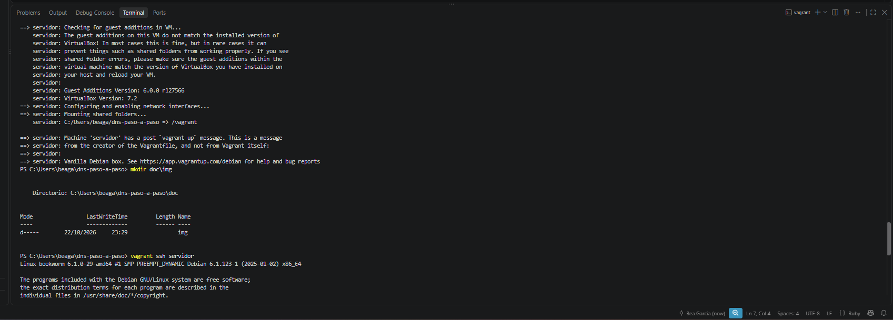

Entro en la máquina y compruebo su IP:

```
vagrant ssh servidor
ip a
```

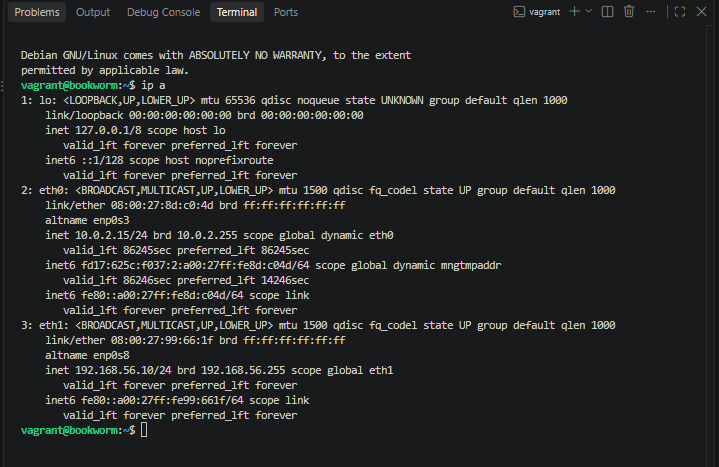

## 2. Comprobación del fichero hosts

Antes de empezar compruebo que el fichero hosts de mi equipo no tiene entradas añadidas, para que vayan de verdad al servidor DNS.

```
Get-Content C:\Windows\System32\drivers\etc\hosts
```

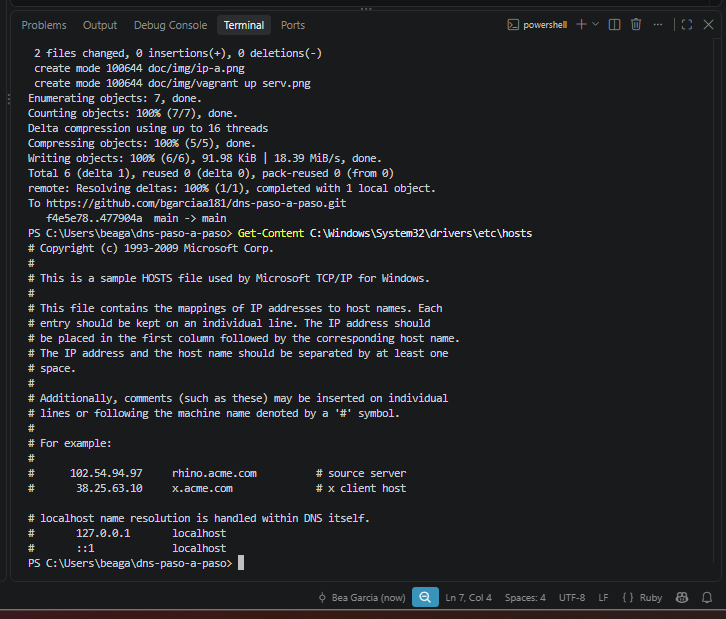

## 3. Instalación del servidor DNS

Bind es el servidor DNS que se usa como estándar y también se le conoce como named. Lo instalo desde los repositorios oficiales con los paquetes bind9, bind9utils y bind9-doc. Añado dnsutils para tener dig y nslookup.

```
sudo apt update
sudo apt install -y bind9 bind9utils bind9-doc dnsutils
```

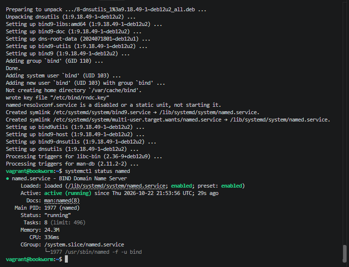

Compruebo que el servicio está activo:

```
systemctl status named
```

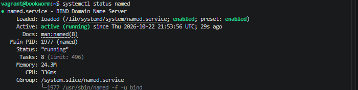

## 4. Configuración del servidor

### Solo IPv4

En clase solo vamos a usar IPv4, así que se lo indico a Bind en `/etc/default/named`:

```
OPTIONS="-u bind -4"
```

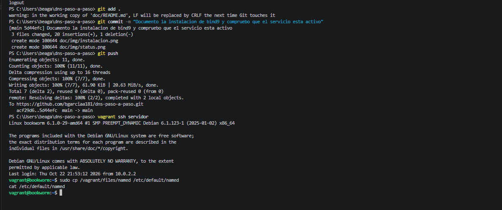

Al principio el fichero se copió vacío y Bind arrancaba sin las opciones (en `systemctl status named` salía solo `named -f`). Al corregirlo, arranca con `named -f -u bind -4`.

### 4.1. Fichero named.conf.options

Antes de modificarlo hago una copia de seguridad:

```
sudo cp /etc/bind/named.conf.options /etc/bind/named.conf.options.backup
```

Añado una lista de acceso (`confiables`) para que solo puedan hacer consultas recursivas los hosts de confianza: el propio servidor y la red 192.168.56.0/24. El fichero queda así:

```
acl confiables {
    127.0.0.1;
    192.168.56.0/24;
};

options {
        directory "/var/cache/bind";

        // forwarders {
        //   0.0.0.0;
        // };

        allow-transfer { none; };

        listen-on port 53 { 127.0.0.1; 192.168.56.10; };

        recursion yes;
        allow-recursion { confiables; };

        dnssec-validation yes;

        // listen-on-v6 { any; };
};
```

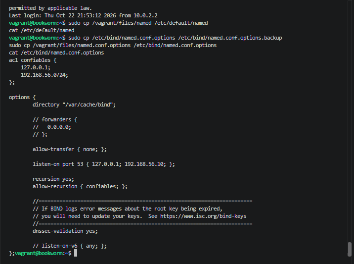

Qué hace cada parte:

- `directory`: es donde Bind guarda la caché (/var/cache/bind). Por defecto ya funciona como DNS caché.
- `allow-transfer { none; }`: no se permite transferir zonas a nadie, de momento.
- `listen-on port 53`: el servidor escucha en el puerto 53 en localhost y en la IP de su tarjeta de red privada.
- `recursion yes` y `allow-recursion { confiables; }`: permito consultas recursivas, pero solo a los hosts de la lista de acceso.
- `dnssec-validation yes`: activa la validación de DNSSEC.
- `listen-on-v6` está comentada porque no vamos a responder consultas IPv6.

Compruebo que la configuración es correcta, reinicio el servicio y miro su estado:

```
named-checkconf /etc/bind/named.conf.options
sudo systemctl restart named
systemctl status named
```

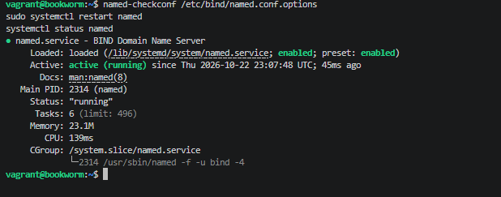

Al comprobar la zona, `named-checkzone` me avisó de que el fichero no terminaba con un salto de línea (`file does not end with newline`). No es un error y la zona cargaba, pero lo corregí añadiendo una línea final al fichero:

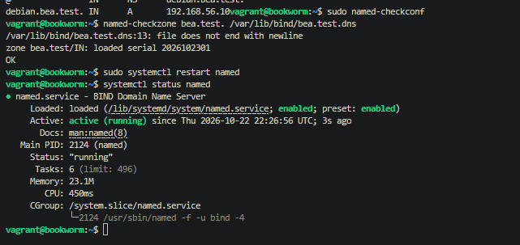

Después de corregirlo, la zona carga sin avisos y el servicio arranca bien:

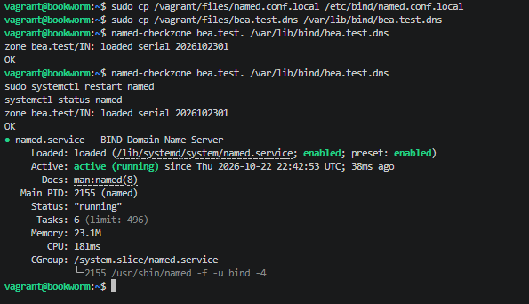

### 4.2. Fichero named.conf.local

En este fichero declaro la zona `bea.test`. Indico que mi servidor DNS es el maestro de la zona y dónde estará su archivo de zona. Antes hago una copia de seguridad:

```
sudo cp /etc/bind/named.conf.local /etc/bind/named.conf.local.backup
```

```
zone "bea.test" {
     type master;
     file "/var/lib/bind/bea.test.dns";
};
```

### 4.3. Archivo de zona de resolución directa

Creo el archivo de zona `/var/lib/bind/bea.test.dns`:

```
;
; bea.test
;
$TTL    86400
@       IN      SOA     debian.bea.test. admin.bea.test. (
                        2026102301      ; Serial
                        3600            ; Refresh
                        1800            ; Retry
                        604800          ; Expire
                        86400 )         ; Negative Cache TTL
;
@                IN      NS      debian.bea.test.
debian.bea.test. IN      A       192.168.56.10
```

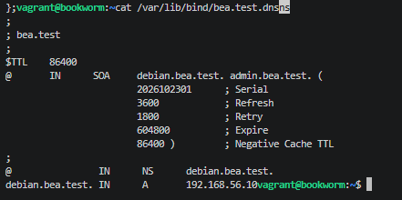

El registro SOA da los datos de la zona autoritativa, el NS indica el servidor DNS de la zona y el A asocia el nombre `debian.bea.test` a su IP. El serial usa el formato AñoMesDíaVersión.

Al comprobar la zona, `named-checkzone` me avisó de que el fichero no terminaba con un salto de línea (`file does not end with newline`). No es un error y la zona cargaba, pero lo corregí añadiendo una línea final al fichero:


Después de corregirlo, la zona carga sin avisos y el servicio arranca bien:


### 4.4. Zona para la resolución inversa

Añado la zona inversa en `named.conf.local`. Su nombre es el tercer byte de mi red al revés, 56.168.192.in-addr.arpa:

```
zone "56.168.192.in-addr.arpa" {
     type master;
     file "/var/lib/bind/bea.test.rev";
};
```

Al reiniciar Bind, el servicio no arrancó. El registro indicaba que la zona `bea.test` estaba definida dos veces en `named.conf.local`: al añadir la zona inversa había dejado el nombre de la zona directa en la segunda declaración.

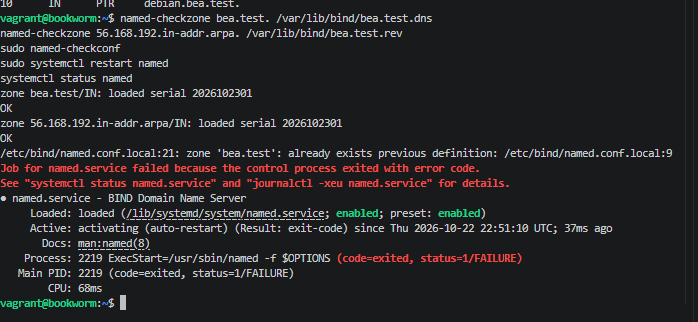

Corregí el nombre de la segunda zona y el servicio arrancó. El fichero queda con las dos zonas:

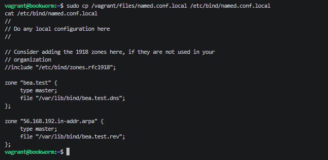

Creo el archivo de zona inversa `/var/lib/bind/bea.test.rev`. El registro PTR asocia el último octeto de la IP (10) con el nombre del servidor:

```
;
; 56.168.192
;
$TTL    86400
@       IN      SOA     debian.bea.test. admin.bea.test. (
                        2026102301      ; Serial
                        3600            ; Refresh
                        1800            ; Retry
                        604800          ; Expire
                        86400 )         ; Negative Cache TTL
;
@       IN      NS      debian.bea.test.
10      IN      PTR     debian.bea.test.
```

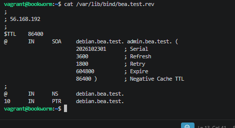

### 4.5. Comprobación de las configuraciones

Compruebo las dos zonas, reinicio el servicio y miro su estado:

```
named-checkzone bea.test. /var/lib/bind/bea.test.dns
named-checkzone 56.168.192.in-addr.arpa. /var/lib/bind/bea.test.rev
sudo named-checkconf
sudo systemctl restart named
systemctl status named
```

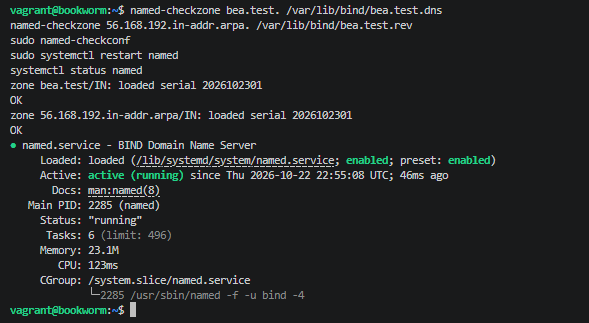

En el registro de Bind se ve que las dos zonas se han cargado con el serial 2026102301:

```
sudo journalctl -u named -n 20 --no-pager
```

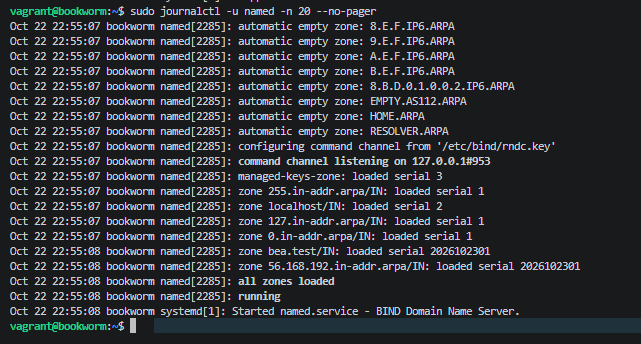
