# Practice: DNS server step by step

## 1. Virtual machine with Vagrant

I create a Vagrantfile for the server machine. It has a private network card in the network 192.168.56.0/24, and its IP is 192.168.56.10. The address .1 is not free, because my own computer uses it.

I use the Debian box `debian/bookworm64`. The Vagrantfile looks like this:

```ruby
Vagrant.configure("2") do |config|
  config.vm.box = "debian/bookworm64"

  config.vm.define "servidor" do |srv|
    srv.vm.network "private_network", ip: "192.168.56.10"
  end
end
```

I start the machine:

```
vagrant up servidor
```


Then I enter the machine and check its IP:

```
vagrant ssh servidor
ip a
```


## 2. Checking the hosts file

Before I start, I check that the hosts file of my computer has no extra lines. If it has, the names could be solved without using my DNS server, and the tests would not be real.

```
Get-Content C:\Windows\System32\drivers\etc\hosts
```


## 3. Installing the DNS server

Bind is the most used DNS server. It is also called named. I install it from the official repositories with the packages bind9, bind9utils and bind9-doc. I also install dnsutils, because it has the commands dig and nslookup.

```
sudo apt update
sudo apt install -y bind9 bind9utils bind9-doc dnsutils
```


I check that the service is running:

```
systemctl status named
```


## 4. Server configuration

### IPv4 only

In class we only use IPv4, so I tell Bind this in the file `/etc/default/named`:

```
OPTIONS="-u bind -4"
```


At the beginning the file was empty when I copied it, so Bind started without these options (`systemctl status named` only showed `named -f`). I fixed it, and now Bind starts with `named -f -u bind -4`.

### 4.1. File named.conf.options

Before I change it, I make a backup copy:

```
sudo cp /etc/bind/named.conf.options /etc/bind/named.conf.options.backup
```

I add an access list called `confiables` (trusted). Only these computers can ask recursive questions: the server itself and the network 192.168.56.0/24. The file looks like this:

```
acl confiables {
    127.0.0.1;
    192.168.56.0/24;
};

options {
        directory "/var/cache/bind";

        // forwarders {
        //   0.0.0.0;
        // };

        allow-transfer { none; };

        listen-on port 53 { 127.0.0.1; 192.168.56.10; };

        recursion yes;
        allow-recursion { confiables; };

        dnssec-validation yes;

        // listen-on-v6 { any; };
};
```


What each part does:

- `directory`: the place where Bind keeps its cache (/var/cache/bind). By default it already works as a cache DNS.
- `allow-transfer { none; }`: nobody can copy the zones, for now.
- `listen-on port 53`: the server listens on port 53 on localhost and on the IP of its private network card.
- `recursion yes` and `allow-recursion { confiables; }`: the server can answer recursive questions (it asks other servers to find the answer), but only for the computers in the list.
- `dnssec-validation yes`: turns on DNSSEC, a security check for DNS answers.
- `listen-on-v6` is a comment, because we do not answer IPv6 questions.

I check the configuration, restart the service and look at its state:

```
named-checkconf /etc/bind/named.conf.options
sudo systemctl restart named
systemctl status named
```


### 4.2. File named.conf.local

In this file I declare the zone `bea.test`. I say that my DNS server is the master of the zone, and where the zone file is. Before I change the file, I make a backup copy:

```
sudo cp /etc/bind/named.conf.local /etc/bind/named.conf.local.backup
```

```
zone "bea.test" {
     type master;
     file "/var/lib/bind/bea.test.dns";
};
```

### 4.3. Forward zone file

I create the zone file `/var/lib/bind/bea.test.dns`:

```
;
; bea.test
;
$TTL    86400
@       IN      SOA     debian.bea.test. admin.bea.test. (
                        2026102301      ; Serial
                        3600            ; Refresh
                        1800            ; Retry
                        604800          ; Expire
                        86400 )         ; Negative Cache TTL
;
@                IN      NS      debian.bea.test.
debian.bea.test. IN      A       192.168.56.10
```


The SOA record gives information about the zone. The NS record says which DNS server answers for the zone. The A record connects the name `debian.bea.test` with its IP. For the serial number I use the format YearMonthDayVersion.

When I checked the zone, `named-checkzone` showed a warning: the file did not end with a new line (`file does not end with newline`). It is not an error and the zone loaded, but I fixed it by adding an empty line at the end of the file:


After the fix, the zone loads without warnings and the service starts well:


### 4.4. Reverse zone

I add the reverse zone in `named.conf.local`. Its name is the third number of my network, and then the rest in reverse order: 56.168.192.in-addr.arpa.

```
zone "56.168.192.in-addr.arpa" {
     type master;
     file "/var/lib/bind/bea.test.rev";
};
```

When I restarted Bind, the service did not start. The log said that the zone `bea.test` was defined two times in `named.conf.local`. When I added the reverse zone, I left the name of the forward zone in the second block.


I fixed the name of the second zone and the service started. Now the file has the two zones:


Then I create the reverse zone file `/var/lib/bind/bea.test.rev`. The PTR record connects the last number of the IP (10) with the name of the server:

```
;
; 56.168.192
;
$TTL    86400
@       IN      SOA     debian.bea.test. admin.bea.test. (
                        2026102301      ; Serial
                        3600            ; Refresh
                        1800            ; Retry
                        604800          ; Expire
                        86400 )         ; Negative Cache TTL
;
@       IN      NS      debian.bea.test.
10      IN      PTR     debian.bea.test.
```


### 4.5. Checking the configuration

I check the two zones, restart the service and look at its state:

```
named-checkzone bea.test. /var/lib/bind/bea.test.dns
named-checkzone 56.168.192.in-addr.arpa. /var/lib/bind/bea.test.rev
sudo named-checkconf
sudo systemctl restart named
systemctl status named
```


In the Bind log I can see that the two zones were loaded with the serial number 2026102301:

```
sudo journalctl -u named -n 20 --no-pager
```


### 4.6. Checking the answers

I check the answers from a client with `dig` and `nslookup`. I want the test machine to use my server as its main DNS, so I change its network configuration:

```
echo "nameserver 192.168.56.10" | sudo tee /etc/resolv.conf
cat /etc/resolv.conf
dig debian.bea.test
```

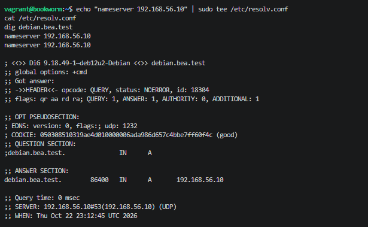

## 5. Checking with dig

I ask the server directly:

```
dig @192.168.56.10 debian.bea.test
```

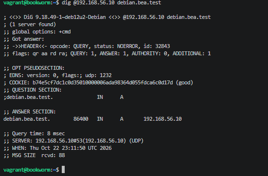

The status is `NOERROR`. The flag `aa` appears because my server is authoritative for the zone, which means it has the original data. In the ANSWER section there is the A record with the IP 192.168.56.10, and the server that answered is 192.168.56.10.

## 6. Checking with nslookup

```
nslookup debian.bea.test 192.168.56.10
```

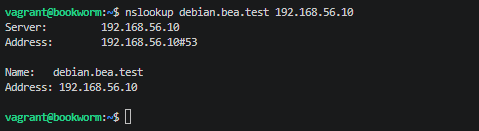

I also check it from my own computer:

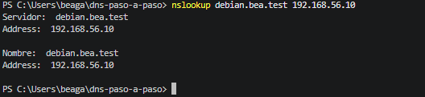

## 7. Extra tasks and checks

### 7.1. More records in the zone

I add an alias and a text record to the zone. I also raise the serial number to 2026102302, so the servers know that the zone changed:

```
web.bea.test.    IN      CNAME   debian.bea.test.
@                IN      TXT     "bgarciaa181"
```

The complete zone file looks like this:

```
;
; bea.test
;
$TTL    86400
@       IN      SOA     debian.bea.test. admin.bea.test. (
                        2026102302      ; Serial
                        3600            ; Refresh
                        1800            ; Retry
                        604800          ; Expire
                        86400 )         ; Negative Cache TTL
;
@                IN      NS      debian.bea.test.
debian.bea.test. IN      A       192.168.56.10
web.bea.test.    IN      CNAME   debian.bea.test.
@                IN      TXT     "bgarciaa181"
```

#### 7.1.1. CNAME record

The alias `web.bea.test` points to the real name `debian.bea.test`:

```
dig @192.168.56.10 web.bea.test CNAME +short
nslookup -type=cname web.bea.test 192.168.56.10
```

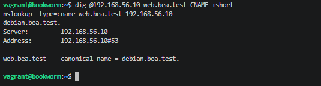

#### 7.1.2. TXT record

I add a TXT record at the root of the zone with my GitHub user:

```
dig @192.168.56.10 bea.test TXT +short
nslookup -type=txt bea.test 192.168.56.10
```

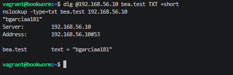

#### 7.1.3. PTR record (reverse resolution)

I check that the IP of the server gives back its full name:

```
dig @192.168.56.10 -x 192.168.56.10 +short
nslookup 192.168.56.10 192.168.56.10
```

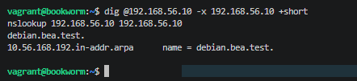

#### 7.1.4. Checking the authority (flag aa)

I ask about my own domain and about an external domain:

```
dig @192.168.56.10 debian.bea.test | grep flags
dig @192.168.56.10 www.google.es | grep flags
```

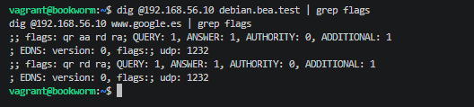

The flag `aa` appears with my domain because my server is the master of the zone `bea.test`, so it answers with its own data. It does not appear with `www.google.es` because my server asks other servers to get that answer.

### 7.2. Check script (test.sh)

I create the script `test.sh` in the main folder of the repository, with permission to run. It checks the server automatically. It checks the syntax of the configuration files and the zones, and then it asks some questions to the DNS server. Later, the last provision script of Vagrant will run it.

```
#!/usr/bin/env bash
echo "=== 1. Comprobación de sintaxis de ficheros ==="
named-checkconf /etc/bind/named.conf.options && echo "[OK] named.conf.options"
named-checkzone bea.test /var/lib/bind/bea.test.dns && echo "[OK] Zona directa"
named-checkzone 56.168.192.in-addr.arpa /var/lib/bind/bea.test.rev && echo "[OK] Zona inversa"

echo "=== 2. Comprobación de resolución ==="
dig @localhost web.bea.test CNAME +short
dig @localhost bea.test TXT +short
dig @localhost -x 192.168.56.10 +short
```

I run it inside the machine:

```
bash /vagrant/test.sh
```

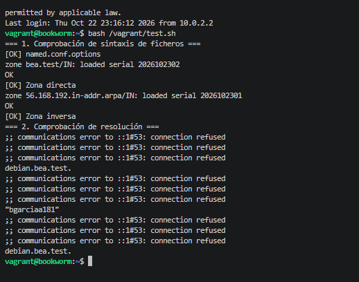

## Automatic deployment with Vagrant

I want the project to start by itself, so I prepare two provision scripts in the folder `config/`. I keep the configuration files in `files/`, and the scripts copy them to the right place inside the machine. This works because the project folder is shared with the virtual machine in `/vagrant`.

`config/provision-servidor.sh` installs Bind, copies the configuration files and restarts the service:

```
#!/usr/bin/env bash
apt-get update
apt-get install -y bind9 bind9utils bind9-doc dnsutils
cp /vagrant/files/named /etc/default/named
cp /vagrant/files/named.conf.options /etc/bind/named.conf.options
cp /vagrant/files/named.conf.local /etc/bind/named.conf.local
cp /vagrant/files/bea.test.dns /var/lib/bind/bea.test.dns
cp /vagrant/files/bea.test.rev /var/lib/bind/bea.test.rev
systemctl restart named
```

`config/test-final.sh` is the last provision script. It runs my check script:

```
#!/usr/bin/env bash
bash /vagrant/test.sh
```

To check that everything works by itself, I destroy the machine and create it again:

```
vagrant destroy servidor -f
vagrant up servidor
```

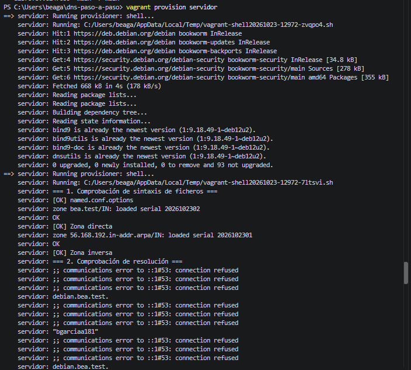

## 8. Second server (secondary)

I add a second virtual machine. It gets a copy of the zones from the first server. The first server has the IP 192.168.56.10, and I give the next IP to the second one: 192.168.56.11.

### 8.1. Creating the second virtual machine

I add the machine `secundario` to the Vagrantfile:

```ruby
config.vm.define "secundario" do |sec|
  sec.vm.network "private_network", ip: "192.168.56.11"
end
```

```
vagrant up secundario
vagrant ssh secundario
ip a
```

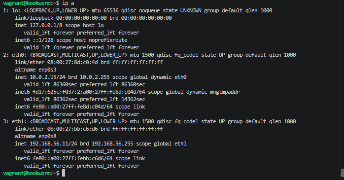

### 8.2. Allowing zone transfers in the primary server

In `named.conf.local` of the primary server, I write the IP of the secondary server in each zone. This way, only that server can ask for a copy of the zones:

```
zone "bea.test" {
     type master;
     file "/var/lib/bind/bea.test.dns";
     allow-transfer { 192.168.56.11; };
};

zone "56.168.192.in-addr.arpa" {
     type master;
     file "/var/lib/bind/bea.test.rev";
     allow-transfer { 192.168.56.11; };
};
```

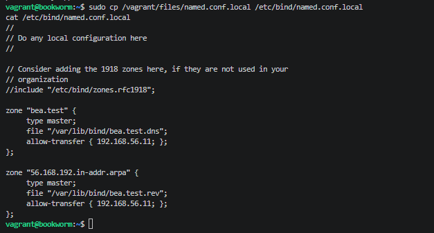

I check the configuration and restart Bind in the primary server:

```
sudo named-checkconf
sudo systemctl restart named
systemctl status named
```

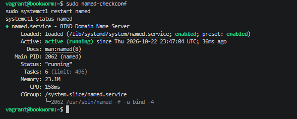

### 8.3. Installing Bind in the secondary server

```
sudo apt update
sudo apt install -y bind9 bind9-utils dnsutils
```

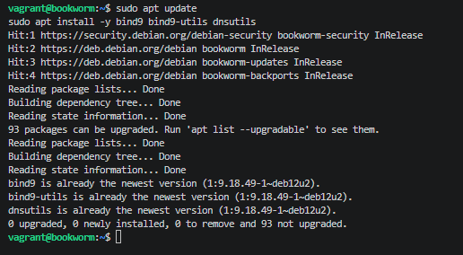

### 8.4. Access list of the secondary server

In `named.conf.options` of the secondary server I use the same list of trusted computers as in the primary server. I only change the listening IP to the IP of the secondary server:

```
acl confiables {
    127.0.0.1;
    192.168.56.0/24;
};

options {
        directory "/var/cache/bind";
        allow-transfer { none; };
        listen-on port 53 { 127.0.0.1; 192.168.56.11; };
        recursion yes;
        allow-recursion { confiables; };
        dnssec-validation yes;
};
```

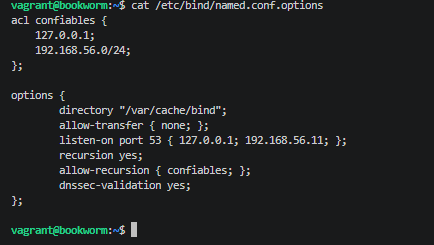

### 8.5. Declaring the slave zones

In `named.conf.local` of the secondary server I declare the two zones as slave zones, and I write the IP of the primary server in `masters`. I do not create the zone files here. The primary server sends them, and Bind saves them in `/var/cache/bind`.

```
zone "bea.test" {
  type slave;
  masters { 192.168.56.10; };
  file "/var/cache/bind/bea.test.dns";
};

zone "56.168.192.in-addr.arpa" {
  type slave;
  masters { 192.168.56.10; };
  file "/var/cache/bind/bea.test.rev";
};
```

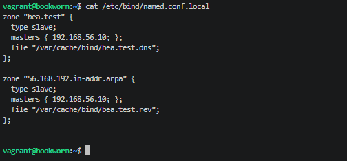

I check the configuration and restart the service:

```
sudo named-checkconf
sudo systemctl restart named
systemctl status named
```

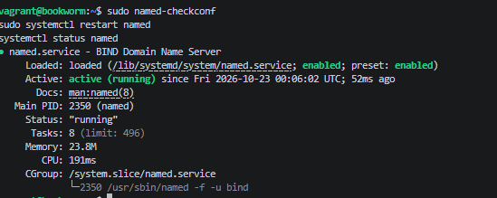

### 8.6. Checking the transfer and the answers

In the log of the secondary server I can see that the two zones were transferred correctly:

```
sudo journalctl -u named --since "10 minutes ago" --no-pager | grep -i transfer
```

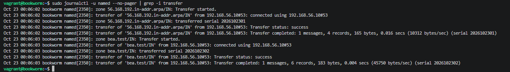

From the primary server, which works as a client, I ask the secondary server directly:

```
dig @192.168.56.11 bea.test SOA +norecurse
dig @192.168.56.11 debian.bea.test A +short
dig @192.168.56.11 -x 192.168.56.10 +short
```

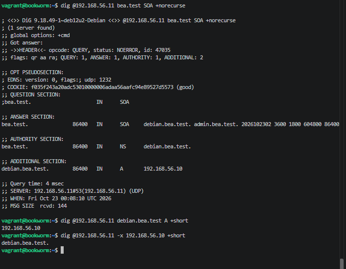

The SOA answer has the flag `aa`, so the secondary server answers with authority. The forward and the reverse questions give the right records. Then I check that both servers have the same serial number:

```
dig @192.168.56.10 bea.test SOA +short
dig @192.168.56.11 bea.test SOA +short
```

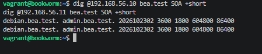

## Automatic deployment of the two machines

I also want the secondary server to start by itself. I create `config/provision-secundario.sh`. It installs Bind, copies the files from `files/secundario/` and restarts the service. At the end it asks both servers for the SOA record, to show that they have the same serial number:

```
#!/usr/bin/env bash
apt-get update
apt-get install -y bind9 bind9-utils dnsutils
cp /vagrant/files/named /etc/default/named
cp /vagrant/files/secundario/named.conf.options /etc/bind/named.conf.options
cp /vagrant/files/secundario/named.conf.local /etc/bind/named.conf.local
systemctl restart named
sleep 5
dig @192.168.56.10 bea.test SOA +short
dig @192.168.56.11 bea.test SOA +short
```

The final Vagrantfile has the two machines. The secondary machine goes after the primary one, because it needs the primary server to be running to get the zones:

```ruby
Vagrant.configure("2") do |config|
  config.vm.box = "debian/bookworm64"

  config.vm.define "servidor" do |srv|
    srv.vm.network "private_network", ip: "192.168.56.10"
    srv.vm.provision "shell", path: "config/provision-servidor.sh"
    srv.vm.provision "shell", path: "config/test-final.sh"
  end

  config.vm.define "secundario" do |sec|
    sec.vm.network "private_network", ip: "192.168.56.11"
    sec.vm.provision "shell", path: "config/provision-secundario.sh"
  end
end
```

I destroy the two machines and create them again from zero, to check that everything works by itself:

```
vagrant destroy -f
vagrant up
```

At the end, the first machine runs the check script and everything is correct:

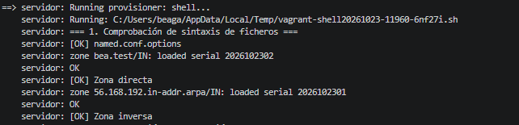

The second machine shows the same serial number as the first one, so the zone transfer works:

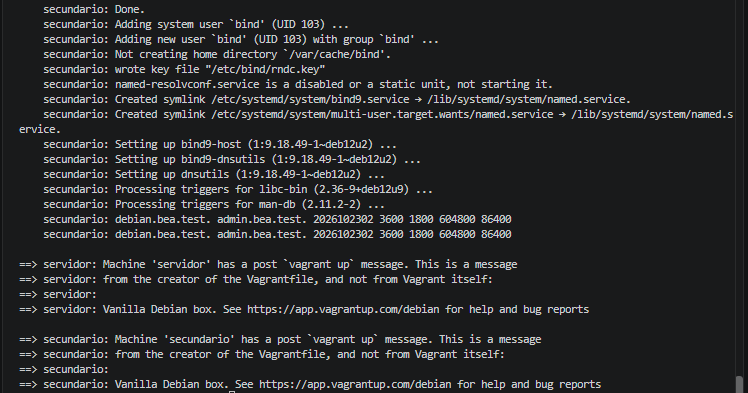
